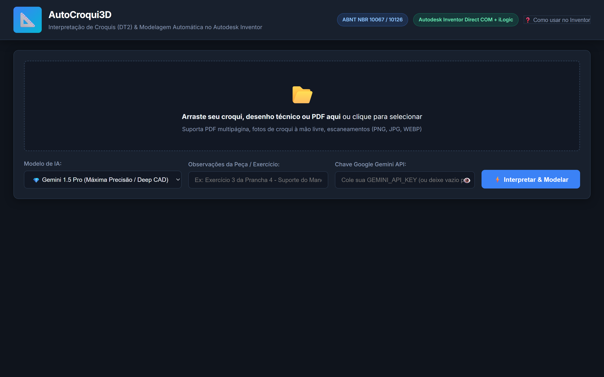

# 📐 AutoCroqui3D — Desenho Técnico 2 & Autodesk Inventor


Sistema inteligente e automatizado para **leitura de croquis mecânicos (à mão livre, escaneados, fotos ou PDFs)** da disciplina de **Desenho Técnico 2**, interpretação semântica de cotas e vistas ortográficas (ABNT NBR 10067 / 10126), e **modelagem 3D automática no Autodesk Inventor**.



---

## 🚀 Funcionalidades Principais

1. **Ingestão Multiformato Completa**:
   - Suporta arquivos **PDF** (páginas únicas ou pranchas completas), **PNG**, **JPG/JPEG**, **WEBP**, **BMP** e **TIFF**.
   - Tratamento automático de contraste, nitidez e orientação de fotos de celular (EXIF).

2. **Interpretação Semântica com IA Multimodal**:
   - Reconhecimento de normas brasileiras (1º Diedro - ABNT NBR 10067 e NBR 10126).
   - Extração de cotas nominais lineares, diâmetros ($\varnothing$), raios ($R$), chanfros (ex: $2 \times 45^\circ$) e furos (passantes e cegos).
   - Decomposição em **Árvore Paramétrica de Operações CAD (CAD Feature Tree)**:
     - Esboço Base $\rightarrow$ Extrusão Primária.
     - Cortes, degraus, ranhuras e rebaixos (subtrações).
     - Furação com coordenadas na face.
     - Chanfros e arredondamentos de acabamento.

3. **Integração Dupla com Autodesk Inventor**:
   - **Modo 1 - Conexão Direta COM API**: Envia os comandos em tempo real para a sessão do Autodesk Inventor aberta no Windows, criando sketches e extrusões com 1 clique.
   - **Modo 2 - Regra iLogic Portável (`.iLogicVb`)**: Gera o código VB.NET nativo do Inventor pronto para ser copiado ou baixado e executado em qualquer computador (inclusive nos laboratórios da faculdade sem precisar de Python instalado).

4. **Visualizador 3D Interativo no Navegador (Three.js)**:
   - Pré-visualização do modelo sólido em 3D antes de modelar no Inventor.
   - Órbita 360°, zoom, pan, modo arestas/wireframe e eixos de referência.
   - Tabela de ajuste fino: permite revisar ou alterar qualquer cota antes de enviar ao Inventor.

5. **Exportação Adicional**:
   - Download da regra iLogic (`.iLogicVb`).
   - Download de geometria 3D universal (`.OBJ`).

---

## 🛠️ Como Executar

### Opção A: Pelo arquivo executador (.bat)
Dê um duplo clique no arquivo:
```cmd
iniciar_autocroqui3d.bat
```

### Opção B: Pelo terminal
```bash
python run.py
```
O servidor iniciará em `http://127.0.0.1:8000` e abrirá automaticamente no seu navegador.

---

## 🔑 Configuração da Chave da API Gemini (Visão Multimodal)

Para utilizar o modelo de visão multimodal avançado (Google Gemini):
1. Obtenha uma chave gratuita no [Google AI Studio](https://aistudio.google.com/).
2. Você pode inseri-la de duas formas:
   - **Diretamente na interface web**: Cole no campo *"Chave Google Gemini API"* (ela é salva localmente no navegador).
   - **Por variável de ambiente**:
     ```powershell
     $env:GEMINI_API_KEY="SUA_CHAVE_AQUI"
     ```
*(Caso não insira a chave, o sistema opera em modo de demonstração com parâmetros de engenharia válidos para testes offline).*

---

## 🏛️ Como Usar no Autodesk Inventor

### Método 1: Envio Direto (1 Clique)
1. Abra o Autodesk Inventor na sua máquina.
2. Na interface do **AutoCroqui3D**, clique no botão **"🚀 Enviar para Autodesk Inventor (Direto)"**.
3. O modelo será construído automaticamente na tela do Inventor!

### Método 2: Via Regra iLogic (Recomendado para Laboratórios da Faculdade)
1. No Inventor, crie uma nova peça métrica (**Standard (mm).ipt**).
2. Vá até a aba **Manage (Gerenciar)** &gt; painel **iLogic** &gt; clique em **Add Rule (Adicionar Regra)**.
3. Escolha um nome (ex: `ModelarCroqui`).
4. Clique em **"Copiar Regra iLogic"** no AutoCroqui3D e cole no editor do Inventor.
5. Clique em **Save & Run (Salvar e Executar)**. A peça será modelada na hora com toda a árvore de features paramétricas!

---

## 🧪 Testes Automatizados

O sistema conta com cobertura de testes nos módulos críticos de geometria, schema, iLogic e API:
```bash
python -m pytest tests/
```
